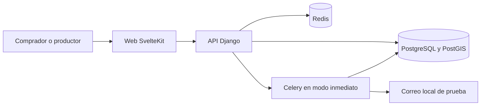

# Primera prueba de CaudalTickets

La base incorpora Revel `v2.22.1` como dos aplicaciones dentro de un repositorio.
La procedencia, los commits originales y sus licencias están documentados en
[UPSTREAM.md](../UPSTREAM.md) y [THIRD_PARTY_NOTICES.md](../THIRD_PARTY_NOTICES.md).

## Componentes

| Componente | Ubicación | Responsabilidad |
| --- | --- | --- |
| Web | `apps/web` | SvelteKit 2, Svelte 5 y TypeScript: eventos públicos, cuentas, compra y panel del productor. |
| API | `apps/api` | Django 5.2 LTS y Django Ninja, Python 3.14: cuentas, organizaciones, eventos, pedidos, entradas y permisos. |
| PostgreSQL con PostGIS | Infraestructura de desarrollo | Datos persistentes y consultas geográficas requeridas por la API. |
| Redis y Celery | Infraestructura de desarrollo | Redis para caché; en esta demo las tareas Celery se ejecutan de forma inmediata en el proceso de la API, sin un worker adicional. |
| Captura de correo local | Infraestructura de desarrollo | Revisar mensajes de prueba sin enviar correo a compradores reales. |

Los scripts de la raíz preparan y ejecutan esta integración. Los documentos
dentro de `apps/` pertenecen al proyecto original; varios comandos asumen
repositorios hermanos y configuración de Revel. Se conserva esa documentación
para referencia, pero los comandos de arranque de CaudalTickets deben seguir la
guía de la raíz.

## Alcance de la prueba

El recorrido a comprobar es: dos productores independientes, un evento público,
un comprador, emisión de entrada y validación QR. Deben comprobarse el rechazo de
un segundo check-in y la separación de datos y permisos entre productores.
La emisión gratuita u offline permite probar ese recorrido sin credenciales
de una pasarela.

Los pagos online de la base usan Stripe Connect. Los pagos reales, el alta de
productores en el país de operación y cualquier adaptación a otra pasarela
requieren una fase posterior. No hay que simular una venta bancaria real ni
activar cobros para demostrar la emisión y validación.

Apple/Google Wallet, Telegram, proveedores de IA, OpenID Connect, Eventbrite,
geolocalización por IP y la observabilidad completa son integraciones opcionales
de Revel. No son prerrequisitos de este primer recorrido. La captura de correo
local permite revisar los mensajes de la demostración; no es un servicio de
correo de producción.

Esta arquitectura describe la integración y el alcance previsto. Los resultados
de instalación y pruebas se deben registrar con la evidencia real: el contenido
de este documento no certifica que el recorrido haya pasado ni sustituye una
evaluación de seguridad para producción.

## Desarrollo y evolución

Cada tarea cloud dispone de un entorno aislado: usar el checkout existente y no
crear un worktree salvo solicitud explícita. Mantener secretos y credenciales
fuera de Git, conservar los lockfiles y registrar los cambios propios respecto
del snapshot para facilitar futuras actualizaciones de seguridad de Revel.

La identidad visual de CaudalTickets y el ecosistema de perfiles creativos,
portafolios y contratación de servicios se desarrollarán sobre esta base; no se
consideran implementados por importar el código original.
